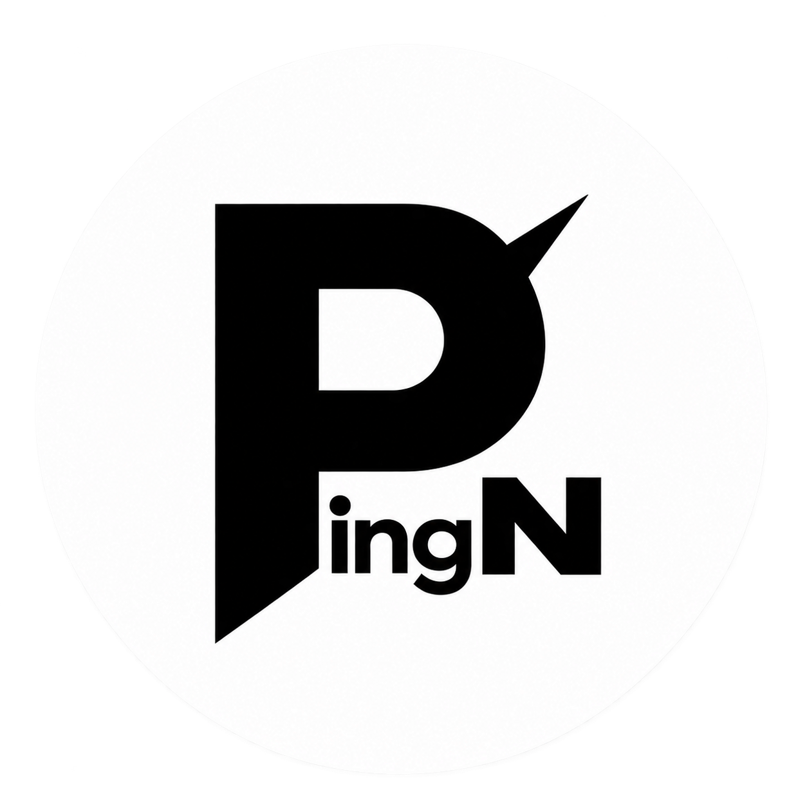

  

<h1 align="center">PingN</h1>

🛡️ کلاینت پراکسی دسکتاپ بر پایهٔ V2rayN، همراه با Cloudflare WARP، Desync و SNI Spoofing Plus

🚀 نسخهٔ منبع فعلی: <code>v7.25.6-PiN52</code>

<a href="README.md">English</a> · <a href="README.fa.md">فارسی</a>

---

## ✨ دربارهٔ PingN

**PingN** یک کلاینت پراکسی دسکتاپ بر پایهٔ پروژهٔ متن‌باز **v2rayN** است. مدیریت پروفایل و اشتراک، مسیریابی، DNS، پروکسی سیستم و TUN را حفظ می‌کند و ابزارهای اختصاصی Cloudflare WARP و اتصال را به آن اضافه می‌کند.

🧩 در نخستین اجرا، PingN یک اشتراک با نام **WARP** می‌سازد و پروفایل‌های **WARP MASQUE/H2** و **WARP AmneziaWG** را در آن قرار می‌دهد. اطلاعات ثبت یا کلید ذخیره‌شدهٔ این دو قابلیت در اتصال‌های بعدی دوباره استفاده می‌شود؛ فشردن **Enter** روی پروفایل WARP انتخاب‌شده، اتصال یا قطع آن را تغییر می‌دهد.

⚡ در حالت **Auto** ابتدا اتصال مستقیم امتحان می‌شود و پس از ۸ ثانیه، در صورت نیاز اتصال از مسیر **Proxy-1** دوباره تلاش می‌شود.

## 💖 حمایت

**TRON:**  
TUnX9wBWzhD2AK9GqB9FJekKaxCvYJNh18

**Nowpayments:**  
https://nowpayments.io/donation/pingplas

## 📊 مقایسهٔ PingN و V2rayN

ستون V2rayN به کد دسکتاپ بالادستی‌ای اشاره دارد که PingN از آن منشعب شده است؛ این جدول دربارهٔ قابلیت‌هایی که ممکن است در نسخه‌های جدیدتر V2rayN اضافه شده باشند ادعایی ندارد.

| قابلیت | نسخهٔ پایهٔ V2rayN | PingN |
| --- | --- | --- |
| مدیریت پروفایل و اشتراک | ✅ | ✅ |
| مسیریابی، DNS، پروکسی سیستم و TUN | ✅ | ✅ |
| هسته‌های Xray و sing-box | ✅ | ✅ |
| ساخت پروفایل‌های WARP | ❌ | ✅ |
| WARP AmneziaWG | ❌ | ✅ |
| WARP MASQUE/H2 | ❌ | ✅ |
| اتصال خودکار | ❌ | ✅ |
| Desync | ❌ | ✅ |
| SNI Spoofing Plus | ❌ | ✅ |

## 💻 سیستم‌عامل‌های پشتیبانی‌شده

| سیستم‌عامل | معماری‌ها |
| --- | --- |
| 🪟 Windows | x64، x86، ARM64 |
| 🐧 Linux | x64، ARM64، riscv64، loong64 |
| 🍎 macOS | x64، ARM64 |

قابلیت‌های افزوده‌شدهٔ PingN محدودیت پشتیبانی دارند:

| 🔧 قابلیت PingN | سیستم‌عامل‌های پشتیبانی‌شده |
| --- | --- |
| 🛡️ WARP AmneziaWG | Windows x64 |
| 🌐 WARP MASQUE/H2 | Windows x64 و ARM64 |
| 🌀 Desync | Windows x64 |
| 🎭 SNI Spoofing Plus | Windows x64 |

⚠️ قابلیت‌های Desync و SNI Spoofing Plus از WinDivert استفاده می‌کنند و هنگام اجرا درخواست تأیید Administrator ویندوز می‌دهند. SNI Spoofing Plus برای TLS معمولی روی TCP است و از Reality، MASQUE، WARP WireGuard یا پروفایل‌های بدون TLS پشتیبانی نمی‌کند.

## 📥 دریافت برنامه

بستهٔ متناسب با سیستم‌عامل و معماری خود را از بخش **Releases** همین مخزن دریافت کنید. فایل‌های انتشار امضا می‌شوند و کلید عمومی و امضاهای جداگانهٔ GPG همراه انتشار قرار می‌گیرند.

## 📜 مجوز

سورس اصلی PingN با مجوز [GPL-3.0](LICENSE) منتشر شده است. اجزای همراه مجوزها و اعلان‌های خودشان را دارند؛ پوشهٔ <code>third_party/licenses/</code> و اعلان کنار هر جزء را ببینید.

PingN پروژه‌ای مستقل و مبتنی بر V2rayN است و نسخهٔ رسمی V2rayN نیست. PingNG پروژهٔ جداگانهٔ اندروید است.

## 🧰 پروژه‌های استفاده‌شده

| پروژه | کاربرد در PingN |
| --- | --- |
| [2dust/v2rayN](https://github.com/2dust/v2rayN) | پایهٔ کلاینت دسکتاپ و امکانات مدیریت پروفایل، مسیریابی و هسته‌ها. |
| [XTLS/Xray-core](https://github.com/XTLS/Xray-core) | هستهٔ پراکسی پشتیبانی‌شده. |
| [SagerNet/sing-box](https://github.com/SagerNet/sing-box) | هستهٔ پراکسی پشتیبانی‌شده. |
| [oberon-core/oberon](https://github.com/oberon-core/oberon) و [AmneziaWG](https://github.com/amnezia-vpn/amneziawg-go) | ساخت پروفایل WARP AmneziaWG، اسکن اندپوینت و اجرای پراکسی محلی. |
| [Diniboy1123/usque](https://github.com/Diniboy1123/usque) | هستهٔ WARP MASQUE/H2. |
| [rezakhosh78/BlackHole](https://github.com/rezakhosh78/BlackHole) و [bol-van/zapret2](https://github.com/bol-van/zapret2) | منبع فایل‌های اجرایی Desync ویندوز؛ سورس برنامه و رابط گرافیکی BlackHole در PingN کپی نشده است. |
| [aleskxyz/sni-spoofing-go](https://github.com/aleskxyz/sni-spoofing-go) | ابزار خط فرمان یکپارچه‌شده با SNI Spoofing Plus. |
| [basil00/WinDivert](https://github.com/basil00/WinDivert) | درایور هدایت بسته‌های شبکه برای ابزارهای Desync و SNI در ویندوز. |
| [vernette/warpscout](https://github.com/vernette/warpscout) | فهرست محدوده‌های IPv4 و IPv6 مورد استفادهٔ اسکنر Oberon. |
| [Avalonia UI](https://github.com/AvaloniaUI/Avalonia)، [Semi.Avalonia](https://github.com/irihitech/Semi.Avalonia) و [ReactiveUI](https://github.com/reactiveui/ReactiveUI) | چارچوب و اجزای رابط کاربری دسکتاپ چندسکویی. |
| [Loyalsoldier/v2ray-rules-dat](https://github.com/Loyalsoldier/v2ray-rules-dat)، [2dust/sing-box-rules](https://github.com/2dust/sing-box-rules) و [MetaCubeX/meta-rules-dat](https://github.com/MetaCubeX/meta-rules-dat) | قوانین مسیریابی و داده‌های GeoIP/geosite. |
| [rezakhosh78/PingNG](https://github.com/rezakhosh78/PingNG) | مرجع رفتار WARP در نسخهٔ موبایل؛ سورس برنامهٔ PingNG در PingN کپی نشده است. |
